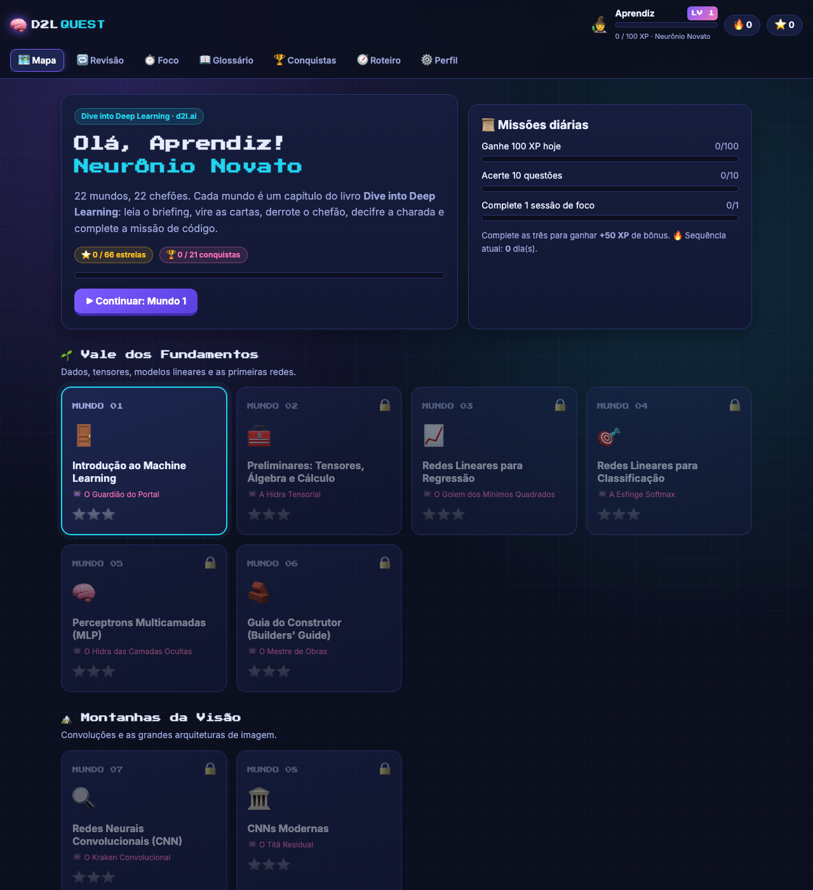
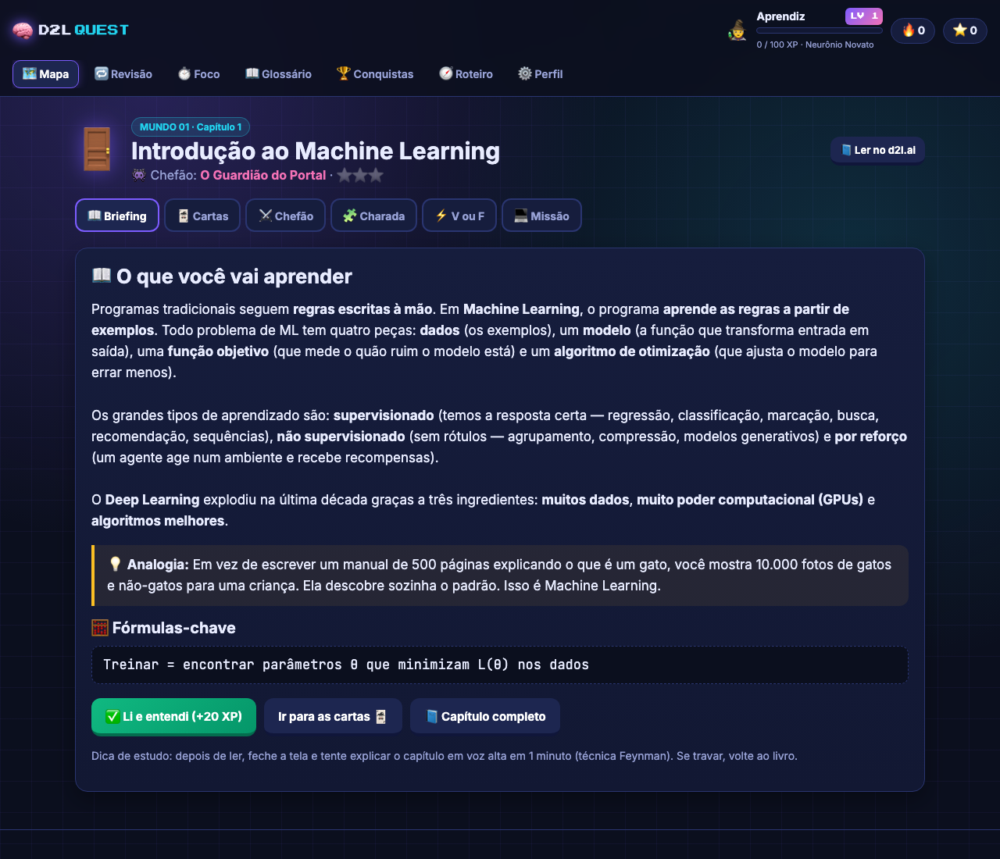
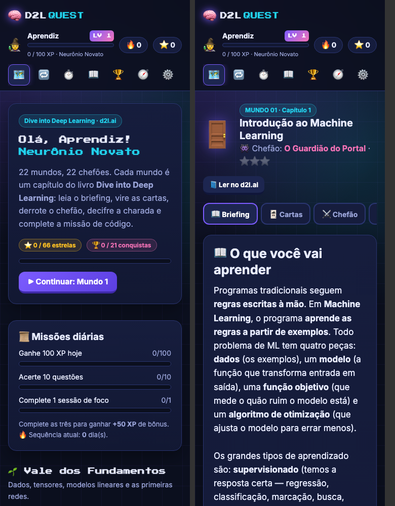

<div align="center">

# 🧠 D2L Quest

### Aprenda Deep Learning jogando — um RPG de estudos para o livro [Dive into Deep Learning](https://d2l.ai)

[](#)
[](#)
[](#)
[](#)
[](#)
[](LICENSE)

**22 mundos · 22 chefões · 132 perguntas · 66 V ou F · 22 charadas · 22 missões de código · 153 conceitos**

[▶ Jogar online](https://jorgyvanlima.github.io/DiveIntoDeepLearning/) ·
[📘 Guia de Estudo](docs/GUIA_DE_ESTUDO.md) ·
[📖 Livro d2l.ai](https://d2l.ai)



</div>

---

## 📌 Sobre o projeto

O **D2L Quest** transforma o livro *Dive into Deep Learning* — um dos melhores materiais gratuitos de deep learning do mundo —
em uma **jornada gamificada**. Cada capítulo do livro vira um **mundo** com um **chefão** a ser derrotado. Você ganha **XP**,
sobe de **nível**, mantém uma **sequência de dias** de estudo, desbloqueia **conquistas** e revisa o conteúdo com
**repetição espaçada**.

O objetivo é simples: **tornar o estudo leve, divertido e constante**, sem perder a profundidade técnica. O app não substitui
o livro — ele **orienta, testa e reforça** o que você lê lá.

> 💡 Funciona 100% no navegador, sem login, sem servidor e sem instalação. O progresso fica salvo no próprio navegador
> (com exportação/importação em JSON).

## ✨ Funcionalidades

| | Funcionalidade | Descrição |
|---|---|---|
| 🗺️ | **Mapa de mundos** | 22 capítulos em 7 regiões. Vença o chefão (≥ 70%) para desbloquear o próximo mundo. |
| 📖 | **Briefing** | Resumo do capítulo em linguagem simples, **analogia do dia a dia** e fórmulas-chave. |
| 🃏 | **Cartas de conhecimento** | Flashcards que viram com um clique — treino de recordação ativa. |
| ⚔️ | **Batalha contra o chefão** | Quiz com 3 vidas ❤️, **combo** de acertos, feedback explicado e atalhos de teclado. |
| 🧩 | **Charadas** | Enigmas sobre o conceito central do capítulo, com dica opcional. |
| ⚡ | **V ou F relâmpago** | Afirmações com cronômetro de 15 s. |
| 💻 | **Missões de código** | Exercícios práticos em **PyTorch** para rodar no Colab/Jupyter. |
| 🔁 | **Arena de Revisão** | Repetição espaçada (sistema **Leitner**: 1, 3, 7, 14 e 30 dias). Os erros voltam primeiro. |
| ⏱️ | **Modo Foco** | Pomodoro gamificado (25/5 configurável) que rende XP. |
| 📜 | **Missões diárias** | 3 metas por dia com bônus de XP ao completar todas. |
| 🏆 | **21 conquistas** | De “Primeiro Sangue” a “Lenda do D2L”. |
| 📖 | **Glossário** | Todos os conceitos pesquisáveis, com link para o mundo de origem. |
| 🧭 | **Roteiro de 12 semanas** | Plano de estudos + técnicas de aprendizagem comprovadas. |
| 💾 | **Backup** | Exportar/importar progresso em JSON. Modo livre para desbloquear tudo. |
| 📱 | **Responsivo** | Funciona no celular, tablet e desktop. Respeita `prefers-reduced-motion`. |

## 🎮 Mecânicas de jogo

| Ação | Recompensa |
|---|---|
| Ler o briefing | +20 XP |
| Virar todas as cartas | +10 XP |
| Acerto no chefão (1ª vez) | +10 XP + bônus de combo (até +10) |
| Vencer o chefão (≥ 70%) | +30 XP e desbloqueia o próximo mundo |
| Gabaritar o chefão (100%) | +50 XP |
| Resolver a charada | +30 XP (15 XP com dica) |
| Acerto no V ou F | +5 XP (+15 XP se acertar todas) |
| Concluir a missão de código | +25 XP |
| Acerto na Arena de Revisão | +5 XP |
| Sessão de foco completa | +15 XP |
| Completar as missões diárias | +50 XP |

**Estrelas por mundo:** ⭐ briefing + cartas · ⭐⭐ chefão ≥ 70% · ⭐⭐⭐ chefão 100% + charada + V ou F perfeito.

**Títulos por nível:** Neurônio Novato → Perceptron Aprendiz → Caçador de Tensores → Explorador de Gradientes → … →
Cavaleiro Transformer → … → **Lenda do Deep Learning**.

## 🗺️ Mundos (capítulos do d2l.ai)

| # | Região | Mundo | Chefão |
|---|---|---|---|
| 1 | 🌱 Vale dos Fundamentos | [Introdução](https://d2l.ai/chapter_introduction/index.html) | O Guardião do Portal |
| 2 | 🌱 Vale dos Fundamentos | [Preliminares](https://d2l.ai/chapter_preliminaries/index.html) | A Hidra Tensorial |
| 3 | 🌱 Vale dos Fundamentos | [Redes Lineares para Regressão](https://d2l.ai/chapter_linear-regression/index.html) | O Golem dos Mínimos Quadrados |
| 4 | 🌱 Vale dos Fundamentos | [Redes Lineares para Classificação](https://d2l.ai/chapter_linear-classification/index.html) | A Esfinge Softmax |
| 5 | 🌱 Vale dos Fundamentos | [Perceptrons Multicamadas](https://d2l.ai/chapter_multilayer-perceptrons/index.html) | A Quimera das Camadas Ocultas |
| 6 | 🌱 Vale dos Fundamentos | [Guia do Construtor](https://d2l.ai/chapter_builders-guide/index.html) | O Mestre de Obras |
| 7 | 🏔️ Montanhas da Visão | [CNNs](https://d2l.ai/chapter_convolutional-neural-networks/index.html) | O Kraken Convolucional |
| 8 | 🏔️ Montanhas da Visão | [CNNs Modernas](https://d2l.ai/chapter_convolutional-modern/index.html) | O Titã Residual |
| 9 | 🌊 Rio das Sequências | [RNNs](https://d2l.ai/chapter_recurrent-neural-networks/index.html) | O Ouroboros Recorrente |
| 10 | 🌊 Rio das Sequências | [RNNs Modernas](https://d2l.ai/chapter_recurrent-modern/index.html) | O Tradutor de Três Portões |
| 11 | 🌊 Rio das Sequências | [Atenção e Transformers](https://d2l.ai/chapter_attention-mechanisms-and-transformers/index.html) | O Dragão Transformer |
| 12 | ⚒️ Forja do Treinamento | [Algoritmos de Otimização](https://d2l.ai/chapter_optimization/index.html) | O Senhor dos Vales |
| 13 | ⚒️ Forja do Treinamento | [Performance Computacional](https://d2l.ai/chapter_computational-performance/index.html) | O Colosso Multi-GPU |
| 14 | 🏙️ Cidade das Aplicações | [Visão Computacional](https://d2l.ai/chapter_computer-vision/index.html) | O Ciclope Detector |
| 15 | 🏙️ Cidade das Aplicações | [PLN: Pré-treinamento](https://d2l.ai/chapter_natural-language-processing-pretraining/index.html) | O Oráculo dos Embeddings |
| 16 | 🏙️ Cidade das Aplicações | [PLN: Aplicações](https://d2l.ai/chapter_natural-language-processing-applications/index.html) | O Juiz das Inferências |
| 17 | 🚀 Fronteira Avançada | [Aprendizado por Reforço](https://d2l.ai/chapter_reinforcement-learning/index.html) | O Agente Errante |
| 18 | 🚀 Fronteira Avançada | [Processos Gaussianos](https://d2l.ai/chapter_gaussian-processes/index.html) | A Névoa das Funções |
| 19 | 🚀 Fronteira Avançada | [Otimização de Hiperparâmetros](https://d2l.ai/chapter_hyperparameter-optimization/index.html) | O Afinador Supremo |
| 20 | 🚀 Fronteira Avançada | [GANs](https://d2l.ai/chapter_generative-adversarial-networks/index.html) | O Falsificador e o Detetive |
| 21 | 🚀 Fronteira Avançada | [Sistemas de Recomendação](https://d2l.ai/chapter_recommender-systems/index.html) | O Algoritmo do Streaming |
| 22 | 🗼 Torre da Matemática | [Matemática para DL](https://d2l.ai/chapter_appendix-mathematics-for-deep-learning/index.html) | O Arquimago da Entropia |

## 📸 Telas

<div align="center">

<br><br>

</div>

## 🚀 Como usar

### Online
Acesse **https://jorgyvanlima.github.io/DiveIntoDeepLearning/** (após ativar o GitHub Pages — veja abaixo).

### Localmente
Não há build nem dependências. Basta servir a pasta:

```bash
git clone https://github.com/jorgyvanlima/DiveIntoDeepLearning.git
cd DiveIntoDeepLearning
./iniciar.sh            # sobe o servidor na porta 8800 e abre o navegador
# ou: python3 -m http.server 8800  →  abra http://localhost:8800
```

> Também funciona abrindo o `index.html` direto no navegador.

### Publicar no GitHub Pages
1. No repositório, vá em **Settings → Pages**.
2. Em **Build and deployment → Source**, escolha **Deploy from a branch**.
3. Selecione a branch **`main`** e a pasta **`/ (root)`** → **Save**.
4. Em ~1 minuto o app estará em `https://<seu-usuario>.github.io/DiveIntoDeepLearning/`.

### Preparar o ambiente para as missões de código
```bash
pip install torch torchvision
pip install d2l==1.0.3
```
Ou use o [Google Colab](https://colab.research.google.com) (GPU grátis).

## 🧭 Método de estudo recomendado

```
 ┌──────────┐   ┌─────────┐   ┌────────┐   ┌─────────┐   ┌──────────────┐   ┌────────┐   ┌──────────┐
 │ Briefing │ → │  Livro  │ → │ Cartas │ → │ Chefão  │ → │ Charada/V-F  │ → │ Missão │ → │ Revisão  │
 │  10 min  │   │ 30-60min│   │  5 min │   │  5 min  │   │    5 min     │   │ 20 min │   │ amanhã   │
 └──────────┘   └─────────┘   └────────┘   └─────────┘   └──────────────┘   └────────┘   └──────────┘
```

- **Recordação ativa** — tente lembrar antes de ver a resposta (cartas e chefões).
- **Repetição espaçada** — revise em intervalos crescentes (Arena de Revisão).
- **Técnica Feynman** — explique o capítulo em voz alta como se fosse para uma criança.
- **Pomodoro** — blocos curtos de foco total (Modo Foco).
- **Aprender fazendo** — toda fórmula deve virar código (Missões).

O plano completo de 12 semanas está no app (aba **Roteiro**) e o material detalhado por capítulo no
**[Guia de Estudo](docs/GUIA_DE_ESTUDO.md)**.

## 🗂️ Estrutura do projeto

```
DiveIntoDeepLearning/
├── index.html               # casca da aplicação (HUD, navegação)
├── css/
│   └── style.css            # tema gamer neon, responsivo
├── js/
│   ├── data.js              # TODO o conteúdo: 22 mundos (resumos, quizzes, charadas, missões)
│   └── app.js               # motor do jogo: rotas, XP, níveis, chefões, Leitner, pomodoro, conquistas
├── docs/
│   ├── GUIA_DE_ESTUDO.md    # guia completo gerado a partir de js/data.js
│   └── screenshots/
├── scripts/
│   └── gerar_guia.js        # gera o guia de estudo em Markdown
├── LICENSE
└── README.md
```

## 🛠️ Arquitetura

- **SPA em JavaScript puro** (sem frameworks, sem build) com roteamento por `hash` (`#/mundo/cnn`, `#/revisao`…).
- **Conteúdo separado da lógica**: tudo que é estudo está em `js/data.js`, em uma estrutura simples e documentada.
- **Estado em `localStorage`** (chave `d2lquest-v1`), com tolerância a falhas (modo privado, storage bloqueado).
- **Repetição espaçada** com caixas de Leitner: acertou → próxima caixa (intervalo maior); errou → volta para a caixa 1.
- **Áudio** gerado via Web Audio API (sem arquivos), **confete** e animações em CSS puro.

## ✍️ Como contribuir com conteúdo

1. Edite `js/data.js` — cada mundo segue o formato:
   ```js
   { id, num, region, emoji, title, boss, url,
     resumo, analogia, conceitos: [{t, d}], formulas: [],
     quiz: [{q, o: [...], a, e}], vf: [{s, v, e}],
     charada: {q, r: [...], dica, e}, missao: {t, d, code} }
   ```
2. Gere o guia de novo:
   ```bash
   # macOS (JavaScriptCore nativo)
   /System/Library/Frameworks/JavaScriptCore.framework/Versions/Current/Helpers/jsc scripts/gerar_guia.js > docs/GUIA_DE_ESTUDO.md
   # ou com Node.js
   node scripts/gerar_guia.js > docs/GUIA_DE_ESTUDO.md
   ```
3. Abra um Pull Request. Sugestões de perguntas, correções e novas charadas são muito bem-vindas!

## 🗺️ Roadmap

- [ ] Mais perguntas por chefão (banco rotativo)
- [ ] Modo “Chefão Final” com perguntas de todos os mundos
- [ ] Fórmulas renderizadas com KaTeX
- [ ] Exportar flashcards para Anki
- [ ] PWA instalável e offline
- [ ] Versão em inglês

## 🙏 Créditos

- Livro **[Dive into Deep Learning](https://d2l.ai)** — Aston Zhang, Zachary C. Lipton, Mu Li e Alexander J. Smola.
  Todo o mérito do conteúdo técnico original é dos autores; este projeto é um **companheiro de estudos não oficial**
  com resumos, perguntas e exercícios escritos em português.
- Fontes: [Press Start 2P](https://fonts.google.com/specimen/Press+Start+2P), [Inter](https://rsms.me/inter/) e
  [JetBrains Mono](https://www.jetbrains.com/lp/mono/).

## 📄 Licença

Código e conteúdo deste repositório sob a licença [MIT](LICENSE). O livro *Dive into Deep Learning* possui licença própria —
consulte o [repositório oficial](https://github.com/d2l-ai/d2l-en).

<div align="center">

**Bons estudos e boa jornada, aventureiro! 🧙‍♂️⚔️🧠**

</div>
